# MarketSignal

A business research workspace for pharmaceutical competitive intelligence across therapy areas. It helps strategy teams discover signals, inspect source evidence and build a research agenda for portfolio, launch and partnership decisions.

## What it does

- Global discovery view across therapy areas, with bounded and explicit source coverage.
- Searchable medicine catalogue with followed products and source-field comparison.
- Dated regulatory decisions, medicine record updates and selected company announcements. Regulatory approvals are never treated as commercial launches.
- Global trial registry snapshot plus on-demand product, company or condition research.
- US NADAC acquisition benchmarks with NDC, currency, unit, effective date and observation date.
- Rule-selected opportunity hypotheses with documented facts, potential relevance, research actions and evidence gaps.
- A sourced analyst chatbot and text brief export. A useful evidence summary remains available if the model service is unavailable.
- Daily collection, retained snapshots, source health and observed changes. The first snapshot is a baseline, not a set of launch alerts.

## Business value and evaluation

Intended users are competitive intelligence, commercial strategy and business development teams. The intended outcomes are faster evidence gathering, earlier investigation of competitor moves and more consistent research decisions. These are intended benefits, not measured impact claims.

Evaluate with a labelled set of business questions. Measure retrieval relevance, correctness of citations, source coverage, time to a reviewed brief, and how often a brief identifies the evidence needed for a decision. Compare analyst time with and without the workspace before making any efficiency claim.

The workspace does not estimate market size, sales, market share, launch probability or expected revenue. An acquisition benchmark cannot establish global net pricing. A late-stage trial is not evidence of clinical success. A withdrawal may be administrative and does not establish unmet demand.

## Source scope

| Source | Collection | Limitation |
| --- | --- | --- |
| EMA medicines JSON | Human medicine records | Centralised procedure, not all nationally authorised EU products. Includes withdrawn, revoked and other non-authorised statuses. |
| FDA Drugs@FDA via openFDA | Up to 300 application records updated in a rolling 180-day query | Application records can contain multiple products and historical submissions. Original and supplemental approval decisions are labelled separately. |
| ClinicalTrials.gov | 200 most recently updated drug/biological interventional studies | Bounded registry snapshot. Targeted research retrieves up to 30 studies and 20 FDA records. |
| CMS Medicaid NADAC 2026 | Latest published weekly CSV linked by official metadata | US community-pharmacy acquisition benchmarks per EA, ML or GM. Not retail, manufacturer net price or reimbursement. Annual source metadata must be reviewed at year-end. |
| GSK and Eli Lilly official feeds | Recent company headlines | Company-reported announcements, limited to the feed. Launch classification requires a launch/availability term in the headline and still requires source review for geography and conditions. |

Official sources:
- https://www.ema.europa.eu/en/about-us/about-website/download-website-data-json-data-format
- https://open.fda.gov/apis/drug/drugsfda/
- https://clinicaltrials.gov/data-api/api
- https://data.medicaid.gov/dataset/fbb83258-11c7-47f5-8b18-5f8e79f7e704
- https://www.gsk.com/en-gb/media/rss-feeds/
- https://investor.lilly.com/rss-news-feeds

## System flow

```mermaid
flowchart LR
    A[Public regulatory, trial, price and company sources] --> B[Scheduled collection]
    B --> C[Normalise records and label evidence]
    C --> D[Compare with prior snapshot]
    D --> E[Retain evidence, changes and source health]
    E --> F[Market radar and research workspace]
    F --> G[Retrieve relevant source records]
    G --> H[Analyst brief: facts, hypotheses, gaps]
    H --> I[Human validation and commercial decision]
```



## Run locally

Requires Node.js 22+. No runtime dependencies.

```sh
cp .env.example .env
# Set GROQ_API_KEY in .env without committing it.
npm test
npm run build
npm start
```

The server listens on http://127.0.0.1:4175. The production model key stays in server-side Vercel environment variables. No account is required to use the public workspace.

## Refresh and hosting

`npm run collect` fetches official sources and writes `dist/data/latest.json`. Individual source failures preserve last-known evidence and mark the source unavailable. A complete failure exits non-zero after writing source health. Empty expected collections are rejected. Changes record observation time separately from source event dates. Limited feeds can cause records to reappear; newly observed records are not assumed to be newly launched. Price and trial changes are only detectable while records remain within the monitored snapshot.

`.github/workflows/monitor.yml` runs daily at 02:47 UTC (08:17 IST), and supports manual dispatch. It commits updated evidence using the repository's built-in token. Schedules can be delayed or disabled by the hosting service. Public repository schedules may be disabled after 60 days without repository activity. Source health and the last run are visible in the app. If an entire job cannot start, the app marks the snapshot stale after 36 hours.

Vercel serves the static workspace and server-side APIs. APIs read the latest committed snapshot with a five-minute process cache and fall back to the bundled snapshot. The monitoring repository URL is configured in `server/data.js`. Source URLs are fixed server-side. API output is paginated. The chatbot uses a server-side Groq model with grounded context and validates returned citation IDs. Citation validation verifies IDs, not the truth of every generated sentence; human review remains necessary. Research rate limits are per process and IP, and are not a distributed abuse-control system.

Followed products remain in the user's browser storage. There are no email alerts, authentication, client-side credentials or claims of exhaustive global coverage. For an enterprise deployment, add durable storage, distributed quotas, access controls, broader licensed coverage and an evaluated alerting workflow.

## Verification

`npm test` covers source normalisation, approval versus launch semantics, US price dates, pricing units and deduplication, estimated trial dates, trusted announcement links, baseline/change detection, data retention during source failure, filtering, opportunity labelling, citation validation, model failure and personal treatment query handling.
